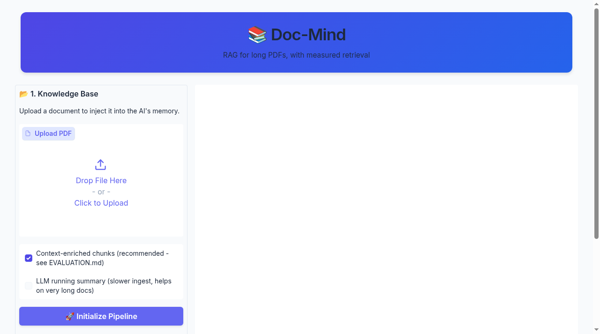

# 📚 Doc-Mind: RAG for long PDFs, with measured retrieval



*The redesigned Doc-Mind interface.*

A locally-hosted Retrieval-Augmented Generation app for chatting with long PDF
documents. 100% local: Mistral-7B via Ollama, `all-MiniLM-L6-v2` embeddings,
FAISS. Built with LangChain LCEL and Gradio.

This repo is less "I built a RAG app" and more "I measured where my RAG app
fails, then fixed it." The measurements are below; the harness that produced
them is in `eval_rag.py`, and the full write-up is in
[DocMind_Report.pdf](DocMind_Report.pdf).

## The problem: context rot on long documents

Chunk a 60-page manual and a sentence like *"The pressure relief valve is
rated at 3825 psi."* shows up in twelve different sections with twelve
different values. The chunk itself never says which section it came from, so
dense retrieval can't tell them apart - and the LLM happily answers with the
wrong section's number. Missing document and section metadata makes similar
passages difficult to distinguish during retrieval; here the failure is
measured at the retrieval stage.

## What I measured

`eval_rag.py` generates a synthetic 60-page service manual (12 sections, 6
component types shared across sections with different spec values, spec
sentences that never name their section) and 24 questions with known ground
truth pages. Same embedding model, same chunking (1200/300), same k=5 as the
app:

| Retriever | Hit@1 | Hit@5 | MRR |
|----------------------------------------------|-------|-------|-------|
| Baseline (bare chunks) | 8.3% | 62.5% | 0.278 |
| Context-enriched chunks (this repo) | 33.3% | **100%** | 0.581 |

Baseline retrieval loses the correct page entirely (not even in top-5) on
9 of 24 questions - 7 of those 9 are past page 20, i.e. the failure gets
worse the longer the document. Prepending a one-line
`[document | section | page]` header to each chunk before embedding fixes
every top-5 miss.

Details, per-question results and reproduction steps: [EVALUATION.md](EVALUATION.md).

## What doesn't work yet (honest list)

- **Hit@1 is still only 33%.** The right chunk is now always in the top 5,
 but ranking it *first* needs a cross-encoder reranker, which I haven't
 added yet.
- **The benchmark is synthetic.** It isolates the near-duplicate-chunk
 failure mode deliberately; it is not a general RAG benchmark. Real-PDF
 numbers will differ.
- **The running-summary mode is unmeasured.** It carries a summary forward
 page by page at ingest, but I haven't built a dataset that isolates its
effect, so it's off by default.
- **Generation quality isn't scored automatically.** `eval_rag.py --gen`
 has the hooks for an LLM-judged answer eval through Ollama, but the
 numbers above are retrieval-only.
- One embedding model (`all-MiniLM-L6-v2`), one chunking config (1200/300),
 one k (5). Nothing is tuned beyond that.

## Architecture

1. **Ingestion** - `PyPDFLoader` → `RecursiveCharacterTextSplitter`
 (1200/300). Each chunk is prepended with its `[document | section | page]`
 context header before embedding (toggleable for A/B).
2. **Optional running summary** - pages are read sequentially and an LLM
 summary is carried forward and prepended to each page's chunks (off by default).
3. **Vector store** - FAISS, cosine similarity, k=5.
4. **Generation** - strict-grounding LCEL chain: refuse when the answer
 isn't in the context, always cite the page. 3-turn sliding-window memory,
 token streaming.

## Run it locally

Requires Python 3.10+ and [Ollama](https://ollama.com).

```bash
git clone https://github.com/ankurrajpat/doc-mind.git
cd doc-mind

python -m venv venv
source venv/bin/activate        # Windows: venv\Scripts\activate
pip install -r requirements.txt

ollama pull mistral             # one-time model download
ollama serve                    # if not already running

python rag_app.py               # opens the Gradio UI
```

Reproduce the evaluation:

```bash
python eval_rag.py make-data    # writes eval_data/kestrel9_service_manual.pdf + qa.json
python eval_rag.py run          # writes eval_data/eval_results.json (baseline vs enriched)
python eval_rag.py run --gen    # optional answer-level eval via Ollama
```

## Repo layout

- `rag_app.py` - the Gradio app
- `eval_rag.py` - the evaluation harness
- `EVALUATION.md` - method + per-question results
- `DocMind_Report.pdf` - engineering report (problem, method, results, limitations)
- `eval_data/` - generated dataset and committed results
